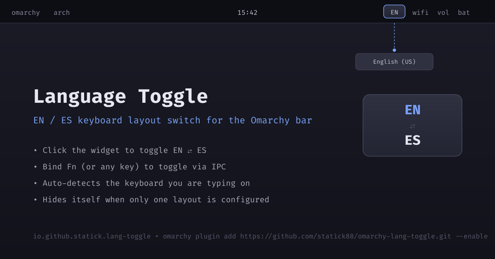

# Language Toggle — EN/ES Keyboard Layout Widget for Omarchy

A simple, useful Omarchy bar widget that shows your current keyboard layout (EN/ES) and lets you toggle between them with a click or the Fn key.

## Preview



*The widget shows "EN" or "ES" in the bar. Click to toggle, or press Fn (when configured).*

## Features

- **Clean display**: Shows "EN" or "ES" in the bar (configurable to show full names)
- **Click to toggle**: Left-click the widget to switch between English and Spanish layouts
- **Fn key support**: Configure a Hyprland keybinding to toggle with Fn key
- **Smart keyboard detection**: Automatically identifies the keyboard you're typing on, ignoring virtual keyboards and system buttons
- **Layout briefs**: Uses xkb's own language codes (en/es) for accurate short labels
- **Only shows when needed**: Widget hides automatically when only one layout is configured

## Installation

### Via Omarchy Plugin Manager (Recommended)

```bash
omarchy plugin add https://github.com/statick88/omarchy-lang-toggle.git --enable
```

This will:
1. Clone the plugin to `~/.config/omarchy/plugins/io.github.statick.lang-toggle/`
2. Validate the plugin manifest
3. Prompt you to place it in a bar section (default: right)
4. Enable it immediately

### Manual Installation

```bash
# Install the plugin from its repository
omarchy plugin add https://github.com/statick88/omarchy-lang-toggle.git

# Validate the plugin
omarchy plugin validate ~/.config/omarchy/plugins/io.github.statick.lang-toggle

# Rescan plugins to load it
omarchy-shell shell rescanPlugins

# Enable and place in bar (right section)
omarchy plugin enable io.github.statick.lang-toggle --section right
```

## Configuration

The widget can be configured via `~/.config/omarchy/shell.json` or the Omarchy settings UI:

```json
{
  "plugins": [
    {
      "id": "io.github.statick.lang-toggle",
      "toggleKey": "Fn",
      "showFullName": "Off"
    }
  ]
}
```

| Setting | Type | Default | Description |
|---------|------|---------|-------------|
| `toggleKey` | string | `"Fn"` | Key to press for toggling (informational, actual binding in Hyprland) |
| `showFullName` | enum | `"Off"` | `"On"` shows "English (US)" instead of "EN" in the bar |

## Fn Key Binding Setup

To use the Fn key to toggle layouts, add this to your `~/.config/hypr/bindings.lua`:

```lua
-- Toggle EN/ES with the Fn key (requires the widget to be loaded)
o.bind("XF86Fn", "Toggle EN/ES Layout",
  "omarchy-shell io.github.statick.lang-toggle toggleEnEs")
```

`XF86Fn` is the keysym Hyprland uses for the Fn key. Plain `FN` and `KEY_FN`
are rejected with `Unknown keysym` on Hyprland, and some keyboards hand Fn to
their own firmware before the compositor ever sees it. If Fn does not reach
Hyprland on your machine, bind a fallback to the same command:

```lua
o.bind("SUPER + SHIFT + L", "Toggle EN/ES Layout",
  "omarchy-shell io.github.statick.lang-toggle toggleEnEs")
```

After editing, reload Hyprland and check for errors:

```bash
hyprctl reload
hyprctl configerrors
```

### IPC command reference

The widget exposes these IPC methods, callable as `omarchy-shell <target> <method>`:

| Method | Effect |
|--------|--------|
| `toggleEnEs` | Switch to the other EN/ES layout |
| `cycleLayout` | Advance to the next layout in the keyboard's list |
| `refresh` | Re-read the keyboard and layout state |

## External Dependencies

Everything below ships with Omarchy or is a standard Arch package. This plugin installs **no** packages, **no** services, **no** systemd units, and **no** remote builds.

| Dependency | Provided by | Used for |
|------------|-------------|----------|
| `omarchy-shell` (Quickshell) | Omarchy Quattro | Plugin runtime, bar widget contract, IPC |
| `hyprctl` | Hyprland | `devices` query and `switchxkblayout` switching |
| `xkbcli` | `xkbcli` package (Arch) | Language briefs for layout labels |
| `xkb` data | `xkb-data` package (Arch) | Layout/variant descriptions read by `xkbcli` |

### Privilege boundary

The plugin runs **unsandboxed inside the long-lived `omarchy-shell` process** with your user's permissions, exactly like every other Omarchy shell plugin. No sudo or pkexec is required, and the plugin never writes outside `~/.config/omarchy/` and never modifies your Hyprland configuration on its own. The only commands it runs are read-only (`hyprctl -j devices`, `xkbcli list`) and one layout-switch command (`hyprctl switchxkblayout`).

### Setup steps

1. Install the plugin (above).
2. Ensure your Hyprland config has both layouts, for example in `~/.config/hypr/input.lua`:

   ```lua
   hl.keyboard({
     layout = {
       { "English (US)", "Spanish (ES)" }
     }
   })
   ```

3. Optionally add the Fn key binding shown above.

The plugin does **not** write to `~/.config/hypr/` — the layout list and the keybinding are yours to configure.

## How It Works

1. **Keyboard Detection**: Queries `hyprctl -j devices` to find all keyboards, filters out virtual keyboards (fcitx5), power buttons, lid switches, and other non-typing devices
2. **Active Keyboard**: Tracks `activelayout` events from Hyprland to know which keyboard you're currently typing on
3. **Layout Reading**: Reads the `active_keymap` from the active typing keyboard
4. **Language Codes**: Uses `xkbcli list --load-exotic` to map xkb descriptions to standard language codes (en/es/fr/de/etc.)
5. **Toggle Logic**: hyprctl describes the active layout by name (`English (US)`) but lists the seat's layouts by xkb code (`latam,us`), so the codes are translated through xkb's own table to find the other EN/ES slot, and the widget switches to it by index

### The two dialects of `hyprctl devices`

This is the detail that makes the toggle work, and the one that is easy to get wrong:

| Field | Example | What it is |
|-------|---------|-----------|
| `kb.active_keymap` | `"English (US)"` | the **description** of the active layout |
| `kb.layout` | `"latam,us"` | the **xkb codes** of the seat's layouts, in slot order |

`hyprctl switchxkblayout` indexes the second one, and the label shows the
first. `"latam"` is the Spanish slot even though it never spells "spanish", so
the codes have to be translated into briefs before the other slot can be found.
The layout list and the active layout must never be compared directly.

## Requirements

- Omarchy Quattro (with `omarchy-shell`)
- Hyprland (for `hyprctl` and `switchxkblayout`)
- `xkbcli` (for layout briefs — `xkbcli` package on Arch)

## Removal

```bash
# Via Omarchy Plugin Manager
omarchy plugin remove io.github.statick.lang-toggle

# Manual removal
rm -rf ~/.config/omarchy/plugins/io.github.statick.lang-toggle
omarchy-shell shell rescanPlugins
```

Removing the plugin does not change your Hyprland layout list or keybindings; clean those up yourself if you added them.

## Development

### Project Structure

```
omarchy-lang-toggle/
├── manifest.json          # Plugin manifest (schemaVersion 1)
├── BarWidget.qml          # Main bar widget (entry point)
├── LangToggleModel.js     # Shared logic (Qt-free, unit testable)
├── preview.png            # Marketplace preview image
├── assets/preview.svg     # Source of the preview image
├── test/
│   ├── unit/
│   │   └── lang-toggle-model-test.js  # Unit tests for model logic
│   ├── integration/
│   │   └── plugin-integration-test.sh # Integration tests
│   └── e2e/
│       └── lang-toggle-e2e.test.js    # Playwright E2E tests
└── odd/
    └── tasks/
        └── lang-toggle.md  # ODD feature document
```

### Running Tests

```bash
# Unit tests (model logic)
node test/unit/lang-toggle-model-test.js

# Integration tests (manifest validation, qmllint, structure)
bash test/integration/plugin-integration-test.sh

# E2E tests (requires running Omarchy shell with test page)
npx playwright test test/e2e/lang-toggle-e2e.test.js
```

### Validating the Plugin

The marketplace requires both checks. The second one needs the shell's QML
imports, so it is run against the installed shell tree:

```bash
# 1. Manifest and repository layout
omarchy plugin validate .

# 2. QML static analysis against the installed shell
qmllint -I "$OMARCHY_PATH/shell" BarWidget.qml
```

`qmllint` lives in the `qt6-tools` package (`/usr/lib/qt6/bin/qmllint` on Arch).

## License

MIT License — see [LICENSE](LICENSE) for details.

## Author

statick88 ([@statick88](https://github.com/statick88)) — see [statick88/omarchy-lang-toggle](https://github.com/statick88/omarchy-lang-toggle).

## Related

- [Omarchy Plugin Marketplace](https://plugins.omarchy.org/)
- [Omarchy Shell Plugin Documentation](https://github.com/omacom/omarchy/blob/quattro/docs/omarchy-shell.md)
- [Marketplace development guide](https://plugins.omarchy.org/develop.html)
